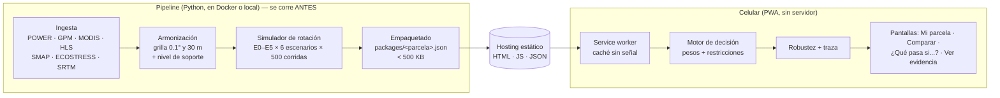

# kinilum — arquitectura de desarrollo

Para el equipo que construye kinilum en el hackathon (14–15 nov 2026). Responde cinco preguntas: cómo se corre, cómo entra un agricultor, cómo se corre la demo, qué se publica en la web estática y si se necesita Docker. Este documento no lleva número de versión: se edita en su lugar y siempre refleja el estado actual. Si algo contradice el PRD vigente, manda el PRD.

## 1. Resumen en cuatro líneas

1. **No hay servidor en producción.** Un *pipeline* por lotes (Python) corre antes de la demo, descarga datos de la NASA y genera un archivo JSON por parcela.
2. **La app es una PWA estática** (TypeScript). Se publica como archivos en un hosting estático, se instala en el celular y funciona sin señal.
3. **Todo el cálculo de decisión ocurre en el celular**, con el motor de decisión sobre los puntajes que trae el paquete. Ninguna llamada a APIs de la NASA sale del navegador.
4. **Docker solo para el pipeline** (por reproducibilidad), nunca para servir la app.

## 2. Vista general



Regla de oro: **si el hosting estático se cae, la demo sigue funcionando** desde la copia local del celular.

## 3. Estructura del repositorio

Un solo repositorio (monorepo), tres zonas con una frontera clara: lo que genera datos, lo que los muestra y lo que ambos comparten.

```
kinilum/
├── pipeline/                 # Python 3.14 — corre por lotes, nunca en la demo
│   ├── ingest/               # un módulo por fuente (power.py, gpm.py, hls.py, ...)
│   ├── harmonize/            # grillas, búfer interno de 30 m, nivel de soporte
│   ├── simulate/             # reglas de cultivo + FAO-56 + 6 escenarios × 500 corridas
│   ├── package/              # arma y valida el JSON de la parcela
│   ├── parcels/              # parcels/<id>.yaml: polígono, suelo, agua, maquinaria, cultivos
│   ├── rules/                # perfil de cultivos versionado, con fuente
│   ├── data/                 # bronce / plata / oro (NO se versiona; en .gitignore)
│   └── Dockerfile
├── app/                      # PWA — TypeScript + Vite
│   ├── src/engine/           # motor de decisión + robustez + sensibilidad (puro, sin UI)
│   ├── src/screens/          # Mi parcela · Comparar · ¿Qué pasa si...? · Ver evidencia
│   ├── src/i18n/             # es.json, en.json — ninguna cadena suelta en componentes
│   ├── public/packages/      # paquetes publicados (solo oro, nunca bronce)
│   └── vite.config.ts        # vite-plugin-pwa (service worker)
├── shared/
│   └── schema/               # JSON Schema del contrato de datos y del paquete
├── docs/                     # PRD, AGENTS-context.md, este archivo
└── Makefile                  # make pipeline · make app · make demo
```

**Por qué el contrato vive en `shared/schema/`:** el pipeline lo usa para validar antes de escribir; la app lo usa para validar al cargar. Si un lado cambia, el otro falla en la prueba, no frente al jurado.

## 4. Cómo se corre (desarrollo)

### 4.1 Pipeline

Requisitos: Python 3.14 (ver sección 13), cuenta de NASA Earthdata (gratis) y un token en variable de entorno. **El token nunca va en el repositorio ni en la app.**

```bash
# Con Docker (recomendado: mismo entorno para las tres personas)
docker build -t kinilum-pipeline pipeline/
docker run --rm -e EARTHDATA_TOKEN -v "$PWD/pipeline/data:/work/data" \
  -v "$PWD/app/public/packages:/work/out" kinilum-pipeline \
  python -m package.build --parcel yuc-demo-001

# Sin Docker (rasterio y las demás librerías geoespaciales traen sus binarios; se instalan con pip)
cd pipeline && pip install -r requirements.txt
python -m ingest.run --parcel yuc-demo-001      # bronce
python -m harmonize.run --parcel yuc-demo-001   # plata
python -m simulate.run --parcel yuc-demo-001    # oro
python -m package.build --parcel yuc-demo-001   # JSON final + validación
```

Cada paso lee de la capa anterior y escribe en la siguiente (bronce → plata → oro). Se puede volver a correr un solo paso sin repetir los anteriores. La ingesta guarda la respuesta cruda de cada fuente con fecha y versión: de ahí sale el campo `provenance` del contrato.

Orden de fuentes (el de mayor riesgo primero): **HLS y MODIS** (las solicitudes hacen fila en los servidores de la NASA), luego GPM y SMAP, luego POWER y SRTM, al final ECOSTRESS.

**Mientras no lleguen los datos de la NASA,** los scripts de ingesta se escriben y se prueban con respuestas simuladas guardadas en `pipeline/tests/fixtures/` (con la forma que documenta cada servicio), y el paquete que consume la app es el de ejemplo escrito a mano. Lo primero que se pide son HLS y MODIS, porque hacen fila; mientras esperan, se piden POWER, GPM y SRTM.

**Reglas de la ingesta ante fallos** (aplican a todo módulo de `pipeline/ingest/`):

- **Reintentos con espera creciente.** Ante un error 429 (demasiadas peticiones) o un 502/503/504, reintentar con espera exponencial (por ejemplo 2, 4, 8, 16 s, con un poco de aleatoriedad) y un máximo de intentos. Los errores 400, 401 y 404 no se reintentan: son un error de la solicitud o del token, y repetirlo no lo arregla.
- **Solicitudes asíncronas.** Las extracciones que la NASA procesa en cola (por ejemplo, las de MODIS y HLS por polígono) se envían una vez, se guarda el identificador de la tarea y se consulta su estado a intervalos crecientes. El script espera; no falla porque la tarea siga en proceso.
- **Reanudable.** Antes de pedir algo, la ingesta revisa si ya existe en bronce con la misma fuente, parcela y rango de fechas. Si el proceso se interrumpe, volver a correrlo continúa donde quedó, no empieza de cero.
- **Falla una fuente, sigue el sistema.** Si una fuente agota sus reintentos, el pipeline lo registra en `provenance` como «sin dato», continúa con las demás y el paquete lo declara. Es la misma regla de degradación elegante del PRD.
- **Sin evadir límites.** Los límites de una fuente se respetan, no se rodean: nada de rotar IP ni disfrazar el cliente. Si una fuente no alcanza, se pide menos o se cambia de fuente.

### 4.2 App

```bash
cd app
npm install
npm run dev         # desarrollo, http://localhost:5173
npm run build       # genera app/dist (lo que se publica)
npm run preview     # sirve dist/ localmente: SIMULA el hosting estático
```

`npm run preview` es la prueba que importa: el service worker no se comporta igual en `dev` que en `build`.

### 4.3 Caché sin señal (service worker)

El paquete de la parcela es un `.json` dentro de `public/packages/`. Con `vite-plugin-pwa`, la lista de archivos que se guardan de antemano (*precache*) incluye por defecto solo `js`, `css` y `html`: **un `.json` no entra por sí solo y la app abriría sin señal pero sin datos.** Por eso:

1. **Declarar el paquete explícitamente.** En la configuración de `vite-plugin-pwa`, agregar `json` a los patrones de archivos que se guardan, o registrar una regla de caché en tiempo de ejecución para `/packages/*.json`.
2. **Descargarlo al primer uso.** Al abrir el enlace por primera vez, la app pide el paquete, lo guarda en el almacenamiento de caché del navegador y muestra «Listo para usar sin señal» solo cuando el archivo ya está guardado. Hasta entonces no lo afirma.
3. **Estrategia de actualización.** Servir primero lo guardado y revisar en segundo plano si hay un paquete más nuevo (*stale-while-revalidate*). Si lo hay, avisar «Hay datos nuevos» y cambiar solo cuando el agricultor acepte, para no cambiar una recomendación a media decisión. El nombre del archivo lleva el identificador de la parcela y la fecha de generación, así un paquete nuevo nunca se confunde con uno viejo en caché.
4. **Verificarlo, no suponerlo.** La prueba de modo avión (sección 4.4) es la única que confirma que esto funciona. Se hace sobre `npm run preview`, nunca sobre `npm run dev`.

### 4.4 Pruebas mínimas (las que sí valen en 48 horas)

| Prueba | Qué detecta |
| --- | --- |
| Validación del paquete contra el esquema | Un dato sin `support_level` o sin `p10`/`p90` no sale del pipeline |
| Prueba del motor con un paquete de ejemplo fijo | Que robustez y «No podemos distinguir» den lo mismo hoy y mañana |
| Presupuesto de tamaño (< 500 KB) | Que el paquete no crezca sin avisar |
| Recorrido en modo avión, **con el paquete ya guardado en caché** | Que la app abra, compare y explique sin red, y que el `.json` esté de verdad guardado |
| Ingesta con una fuente que falla a propósito | Que el pipeline reintente, registre «sin dato» y siga |
| Búsqueda de coordenadas exactas en `dist/` | Que no se publique la ubicación precisa de la parcela (sección 5.3) |

## 5. Cómo entra un agricultor

### 5.1 Flujo real (lo que el producto promete)

1. **El técnico configura la parcela** en un archivo `parcels/<id>.yaml`: polígono, tipo de suelo (tsek'el, k'ankab o sin declarar), agua (temporal o riego), maquinaria, cultivos aceptables, manejo del rastrojo.
2. **El técnico corre el pipeline** y publica el paquete. Hoy es un comando; en el MVP no hay pantalla de administración.
3. **El agricultor recibe un enlace o un código QR** con el identificador de la parcela: `https://<sitio>/#/p/<id-opaco>`.
4. **Abre el enlace en su celular**, el navegador ofrece «Instalar», y la app descarga el paquete una sola vez y lo guarda.
5. **Desde ahí funciona sin señal.** Elige su objetivo, ve las rutas, mueve los controles. Lo que declara queda en el propio celular.
6. **Cierra con «La decisión es suya. Revísela con su técnico local.»** y puede guardar un registro local de lo que decidió.

**No hay cuenta ni contraseña.** El identificador de la parcela es el único acceso. Eso es coherente con el PRD (sin login) y es también la razón por la que el identificador debe ser largo y no adivinable.

### 5.2 Qué vive dónde

| Dato | Dónde | Quién lo ve |
| --- | --- | --- |
| Paquete de la parcela (puntajes, evidencia) | Hosting estático y caché del celular | Cualquiera con el enlace |
| Lo que el agricultor declara (objetivo, restricciones, decisión) | Almacenamiento local del navegador | Solo ese celular |
| Datos crudos de la NASA | Solo en la máquina del pipeline | El equipo |

### 5.3 Privacidad: decidir antes de publicar

Todo lo que va a `dist/` es público. Para la demo, usar **una parcela de ejemplo representativa o la de un agricultor que haya aceptado por escrito**, no la de alguien que no sabe que aparece en un enlace público. Reglas de publicación:

- **El paquete no lleva el polígono exacto.** Los puntajes y la evidencia no lo necesitan: el cálculo con el polígono (búfer de 30 m, extracciones por píxel) ocurre en el pipeline. En el paquete solo va un **punto de referencia redondeado a dos decimales** (unos 1 000 m) y la superficie en hectáreas, lo suficiente para ubicar la zona y no la parcela.
- **El polígono exacto y `parcels/<id>.yaml` no se publican.** Viven en el repositorio privado o en la máquina del pipeline. Si el repositorio es público, el archivo de la parcela de demo contiene solo datos de la parcela de ejemplo.
- **Ni nombres ni datos personales** del agricultor en el paquete, en el repositorio ni en el video. La parcela se identifica con un código opaco (`yuc-demo-001`).
- **Revisión antes de publicar.** Buscar en `app/dist/` coordenadas con más de dos decimales y cualquier nombre propio (prueba de la sección 4.4).
- **Si la ubicación aproximada tampoco puede mostrarse**, la «Ver evidencia» dice «región sur de Yucatán» sin punto de referencia. La explicación no pierde nada: las fuentes de zona ya se presentan como contexto, no como mancha dentro de la parcela.

El mapa de 30 m (opcional, de los primeros en cortarse) necesita el polígono. Si sobrevive al orden de corte, solo se publica para la parcela de ejemplo, nunca para una real sin permiso.

## 6. Cómo se corre la demo

### 6.1 Antes

1. Ensayar todo con el paquete de ejemplo. En cuanto lleguen los datos, congelar el polígono y correr el pipeline con las fuentes del núcleo. Si una fuente no llega a tiempo, el paquete la declara «sin dato», o se rotula como ejemplo si todo sigue siendo de ejemplo.
2. `npm run build` y publicar `dist/` en el hosting estático (sección 7).
3. Abrir el enlace público en **el celular de la demo**, instalar la PWA y esperar a que descargue el paquete.
4. **Prueba en modo avión:** cerrar la app, activar modo avión, abrir de nuevo y recorrer las cuatro pantallas. Si falla, no se sigue hasta arreglarlo.
5. Probar en un segundo celular y en otro navegador, con datos móviles y con wifi.

### 6.2 Durante

| Rol | Qué usa | Para qué |
| --- | --- | --- |
| Principal | Celular con la PWA instalada, **en modo avión**, duplicado en pantalla | Muestra que funciona sin señal |
| Respaldo 1 | Laptop con `npm run preview` en `localhost`, sin internet | Si falla el celular |
| Respaldo 2 | Video de 30 s (el mismo del envío) | Si falla todo lo demás |

Un código QR en la diapositiva final lleva al enlace público, para que el jurado lo abra en su propio celular.

### 6.3 Primer arranque: el único momento que necesita señal

El modo avión solo funciona **después** de que el celular descargó la app y el paquete. La primera apertura de un enlace sí necesita conexión, y es el punto más frágil de toda la demo.

- **Nunca se hace el primer arranque en el escenario.** El celular de la demo ya tiene la PWA instalada y el paquete guardado desde el día anterior. Esa es la condición de salida de la sección 6.1, no un detalle.
- **Comprobación de salida, el mismo día de la demo, con señal:** abrir la app, esperar el aviso «Listo para usar sin señal», cerrarla del todo, activar modo avión y abrirla de nuevo. Se repite en cada celular que vaya a usarse.
- **Si el sitio lo permite, usar la señal propia.** Un punto de acceso desde otro celular con datos móviles evita depender del wifi del lugar para cualquier paso que sí lo necesite.
- **El jurado y su propio celular:** quien escanee el QR hará su primer arranque con la red que tenga. Si falla, no es un fallo de la demo: se muestra el celular principal o el video. Por eso el QR va junto al video, no en lugar de él.
- **Nunca se promete «funciona sin señal» sin mostrarlo en el celular ya preparado.**

### 6.4 Qué no debe pasar en vivo

- Descargar datos de la NASA o correr el pipeline. Es por lotes y tarda.
- Depender del wifi del lugar.
- Llamar a un modelo de lenguaje. La demo no lo necesita (sección 8).

## 7. Qué se publica en la web estática

Se publica **la carpeta `app/dist/`**: HTML, JavaScript, estilos, fuentes, archivos de idioma y `packages/<id>.json`. Nada más.

| Se publica | No se publica |
| --- | --- |
| La PWA compilada | `pipeline/` y sus datos (bronce, plata) |
| El paquete de la parcela (oro) | Tokens de Earthdata y cualquier clave |
| Archivos de idioma (es, en) | Datos crudos de la NASA |
| Punto de referencia redondeado y superficie | El polígono exacto y `parcels/<id>.yaml` |
| Página «Acerca de» con fuentes, datos de la NASA usados y declaración de uso de IA | Archivos de otros agricultores |

**Dónde:** cualquier hosting estático con HTTPS (el service worker lo exige). Opciones, de más simple a menos:

1. **GitHub Pages** con una acción de GitHub que corre `npm run build` y publica `dist/`. Ya viven en GitHub, el enlace es público y no pide inicio de sesión (requisito de envío).
2. **Cloudflare Pages** o **Netlify**, si quieren vista previa por rama.

**Cuidado con la ruta base.** En GitHub Pages el sitio vive en `/<repo>/`, no en `/`. Hay que fijar `base` en `vite.config.ts` o los archivos no cargan. Es el error más común de la primera publicación; probarlo con tiempo, no a última hora.

**Contenido que debe mostrar el enlace público** (lo que pide el envío): la app funcionando, la lista de datos de la NASA usados, la declaración de uso de IA y el aviso de que la decisión final es del agricultor y del técnico.

## 8. ¿Y el modelo de lenguaje?

La app estática no puede llamar a un modelo sin exponer una clave, así que **no lo hace**. Opciones, de la más segura a la menos:

1. **Plantillas fijas** para la traza de decisión. Sin modelo, sin riesgo. Es lo mínimo y es suficiente para la demo.
2. **Redacción previa en el pipeline:** el modelo escribe los textos a partir de la traza *durante el empaquetado*, el paquete los guarda marcados con `generated_by`, y la app solo los muestra. El modelo nunca calcula ni decide y nunca corre en el celular.

Cualquiera de las dos cumple la regla del PRD («el modelo solo redacta desde la traza; la demo funciona sin él») y se declara en el envío. No se agrega un servidor para esto.

## 9. ¿Debe correr con Docker?

| Parte | ¿Docker? | Razón |
| --- | --- | --- |
| Pipeline | **Sí, recomendado** | Una imagen fija la versión de Python y de cada librería, y las tres personas obtienen el mismo resultado. Ya no es obligatoria: las librerías geoespaciales publican paquetes con sus binarios incluidos (comprobado para Python 3.13 y 3.14), así que la instalación local suele funcionar |
| App en desarrollo | No | `npm run dev` basta y es más rápido |
| App en la demo | **No** | Son archivos estáticos. Añadir contenedores es añadir una pieza que se puede romper |
| Base de datos | No existe | El paquete JSON es la base de datos |

Si en algún momento un contenedor sirve la app, que sea solo como respaldo local (`nginx` sirviendo `dist/`), pero `npm run preview` ya cumple ese papel con menos piezas.

## 10. Decisiones y límites honestos

- **El técnico no tiene pantalla en el MVP.** Configura un archivo y corre un comando. Es una simplificación deliberada; se declara así en el PRD y en el video.
- **Una parcela, una región.** El pipeline acepta otras parcelas con otro archivo `yaml`, pero solo una está validada para la demo.
- **Los paquetes envejecen.** Un paquete refleja datos hasta su fecha de generación. La app muestra esa fecha en «Ver evidencia». Actualizar es volver a correr el pipeline, no es automático.
- **Sin sincronización.** Lo que el agricultor declara no sale de su celular.

## 11. Orden de construcción sugerido (si el tiempo aprieta)

1. Esquema del paquete + un paquete de ejemplo escrito a mano → la app se puede construir sin esperar al pipeline.
2. Motor de decisión + robustez sobre ese ejemplo, con sus pruebas.
3. Pantallas y service worker, probadas en modo avión desde el primer día.
4. Pipeline real, fuente por fuente, reemplazando el ejemplo.
5. Publicación estática y ensayo completo.

Mientras llegan los datos, los pasos 1 a 3 se hacen y se prueban con el paquete de ejemplo, y el paso 4 empieza cuando lleguen. Así la demo funciona de punta a punta desde el principio, y cada fuente real que llegue mejora lo que ya existe. Coincide con la regla del PRD: «lo más simple que mantenga la demo de punta a punta, real y sin señal».

## 12. Trabajo en equipo en GitHub

Tres personas (Jorge, Isis e Isabella), sin módulos asignados: cualquiera toma cualquier parte. El código sigue separado por módulo, en carpetas:

| Módulo | Carpeta |
| --- | --- |
| Contrato de datos | `shared/schema/` |
| Ingesta de datos y Docker del pipeline | `pipeline/ingest/`, `pipeline/Dockerfile` |
| Simulador y armado del paquete | `pipeline/simulate/`, `pipeline/package/` |
| Motor de decisión | `app/src/engine/` |
| Pantallas | `app/src/screens/` |
| PWA offline, despliegue y privacidad | `app/` (service worker), `.github/workflows/`, `scripts/` |

**El contrato es la interfaz.** Es como el esquema de una tabla compartida: si todos escriben contra el mismo esquema, nadie necesita leer el código de los demás. Por eso el primer trabajo es el esquema y un paquete de ejemplo escrito a mano.

**Integración:** cada persona trabaja en su rama y fusiona su propio pull request cuando pasa la verificación automática (esquema, pruebas, compilación y revisión de privacidad). No se espera aprobación humana. Solo `shared/schema/` exige la de Jorge. Una IA de revisión puede comentar, pero no aprueba. Cada módulo sube sus pruebas junto con su código: cuantas más pruebas, menos revisión humana hace falta.


## 13. Lenguajes, versiones y seguridad de dependencias

### 13.1 Lenguajes: los menos posibles, los de menor mantenimiento

Dos lenguajes en total, y ningún servidor que escalar ni parchear. El mantenimiento más bajo es no tener piezas que mantener, y esta arquitectura ya parte de ahí: lo que se escala es un hosting estático con red de distribución (CDN), que escala solo.

| Parte | Lenguaje | Por qué | Solo se cambia si |
| --- | --- | --- | --- |
| Ingesta y armonización | **Python** | `rasterio`, `xarray`, `earthaccess` y `pandas` no tienen equivalente en otro lenguaje para datos satelitales | No se cambia |
| Simulador | **Python con NumPy vectorizado** | Son unas 18 000 corridas (6 escenarios × 500 × 6 estrategias) más la grilla de controles. Escritas como operaciones sobre arreglos, tardan segundos | Una corrida completa tarda más de unos pocos minutos: primero se mide dónde, se vectoriza mejor y solo después se piensa en otra herramienta |
| Motor de decisión y pantallas | **TypeScript en modo estricto** | Un solo lenguaje en el celular; los tipos evitan errores de datos que se verían frente al jurado | El motor no cumple los 50 ms en un Android de gama baja **medido**: solo el ciclo caliente pasa a WebAssembly (Rust) |
| Automatización | **YAML (GitHub Actions) y los scripts de Python** | Nada nuevo que aprender | No se cambia |

**Por qué no Go ni Rust como lenguaje base:** no hay servicios que atiendan peticiones, así que su ventaja principal (rendimiento sostenido de un servidor) no aplica. El cuello de botella es la espera a los servidores de la NASA, no el procesador. Y tres personas con perfiles distintos en 48 horas no deben aprender un lenguaje nuevo. Rust queda como salida concreta y acotada si una medición lo pide.

**Una sola fuente de verdad para el contrato.** Los tipos de TypeScript se generan desde `shared/schema/` (por ejemplo, con `json-schema-to-typescript`) y el pipeline valida con el mismo esquema. Así el contrato y el código no se desalinean sin que el CI lo note. Es una mejora de prioridad P1: si no hay tiempo, la validación del esquema en CI ya cubre lo esencial.

### 13.2 Versiones en producción

Regla: **solo versiones con soporte de seguridad vigente**:

| Componente | Versión a usar | Estado | No usar |
| --- | --- | --- | --- |
| Python | **3.14** (alternativa: 3.13) | 3.14: correcciones hasta oct 2027 y seguridad hasta oct 2030. 3.13: solo seguridad, hasta oct 2029 | 3.15 (salió el 9 oct 2026, demasiado nueva); 3.10 (fin de vida el 1 oct 2026) |
| Node.js | **24 LTS** (alternativa: 22 LTS) | 24 con soporte hasta abril de 2028; 22 hasta abril de 2027 | **Node 20: fin de vida el 30 abril 2026** |
| Imagen de Docker | `python:3.14-slim` | Fijada por versión y por resumen (*digest*) | `latest` |

Antes de fijar, confirmar en [endoflife.date/python](https://endoflife.date/python) y en la página de versiones de nodejs.org, porque estas fechas cambian. Las librerías geoespaciales (`numpy`, `pandas`, `scipy`, `rasterio`, `xarray`, `shapely`, `pyproj`, `earthaccess`) tienen paquetes publicados para 3.13 y 3.14; si alguna falla al instalar, se baja a 3.13, no a una versión sin soporte.

### 13.3 Cómo se mantienen fijas

- **Una sola fuente de versión.** `.nvmrc` (Node) y `.python-version` (Python) en la raíz; el CI y el Dockerfile las leen (`node-version-file`, `python-version-file`), así no se desalinean.
- **Archivos de bloqueo (*lockfiles*) siempre.** `package-lock.json` con `npm ci`, nunca `npm install` en CI. En Python, `requirements.txt` con versiones exactas y sumas de verificación (`pip install --require-hashes`).
- **Imagen mínima y sin privilegios.** `python:3.14-slim` fijada por *digest*, usuario sin privilegios de administrador, sin el token dentro de la imagen (se pasa en tiempo de ejecución, nunca como `ARG` ni copiado).
- **Pocas dependencias.** Antes de agregar una: ¿tiene mantenimiento reciente?, ¿licencia compatible con código abierto?, ¿se justifica frente a escribir diez líneas? Nada de paquetes para funciones triviales. Revisar bien el nombre antes de instalar: los paquetes con nombre casi igual a uno conocido son una vía de ataque habitual.
- **Fuentes tipográficas dentro del paquete**, no desde un servicio externo: es más privado y es necesario para funcionar sin señal.

### 13.4 Vulnerabilidades: lo que se activa (gratis en repositorios públicos)

| Qué | Cómo |
| --- | --- |
| Alertas y actualizaciones de seguridad de dependencias | **Dependabot** para `npm`, `pip`, `github-actions` y `docker`, con revisión semanal |
| Claves filtradas | **Secret scanning** y *push protection*, que bloquea el commit antes de que salga |
| Vulnerabilidades conocidas en el CI | `npm audit --omit=dev --audit-level=high` y `pip-audit`; fallan solo con hallazgos altos o críticos en dependencias que sí se publican |
| Acciones de GitHub | Solo las oficiales (`actions/*`), a la versión mayor vigente, actualizadas por Dependabot |
| Resultado publicado | Solo archivos estáticos: sin servidor, sin base de datos y sin sistema operativo que parchear |
| Política de contenido | Etiqueta `<meta http-equiv="Content-Security-Policy">` que limita scripts y conexiones al propio sitio (GitHub Pages no permite cabeceras propias). Si el mapa opcional carga mosaicos externos, se añade solo ese origen |

Responsables: Isabella lleva la política de dependencias y vulnerabilidades, e Isis el endurecimiento de la imagen de Docker.

**Alcance honesto:** esto reduce la superficie de ataque; no la elimina. Un hackathon de 48 horas no justifica una auditoría completa. Lo que sí es innegociable: ninguna versión sin soporte, ninguna clave en el repositorio y ningún dato de una persona en lo que se publica.

## Fuentes

- Documento rector: el PRD ágil y `docs/AGENTS-context.md`.
- [NASA Earthdata Login](https://urs.earthdata.nasa.gov/): cuenta necesaria para HLS, MODIS, SMAP, GPM y ECOSTRESS.
- [NASA POWER](https://power.larc.nasa.gov/): sin autenticación, licencia CC BY 4.0.
- [endoflife.date, Python](https://endoflife.date/python): versiones con soporte.
- [Space Apps, guía de envío](https://www.spaceappschallenge.org/resources/project-submission-guide/): enlace público sin login, datos de la NASA usados, declaración de uso de IA (confirmar la guía 2026).
